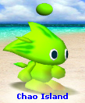

# Baby Run revision: reference use and palette scope — 0.25.53

This revision uses the user's two supplied images as different kinds of evidence. The intended creature remains an ordinary **Hero-aligned, Run-trained baby**. A reference photograph's Neutral alignment is not a request to change that goal.

## Supplied Run-shape reference

The green, swept-back Chao photograph was located in the public Chao Island [Run gallery](https://chao-island.com/gallery/chao-types/run.html), where it is the **Neutral Regular Two-tone Run** first-evolution photograph:

[Original photograph](https://chao-island.com/assets/images/gallery/twotone/run/neutralruntwotoneregular.jpg)

*Matching public-source copy of the small supplied reference; not a reconstructed image.*

- Downloaded dimensions: 109 × 132 pixels.
- SHA-256: `22f6b4d330c9599e60db306964042fc3d2c2bea8eb34255cb8a733b0b97f215e`.
- The freshly downloaded photograph visually matches the small green reference supplied in this conversation. The chat does not expose the uploaded image's original bytes, so the matching public-source copy is distinguished from a byte-for-byte copy of the upload.
- The important shape features are a distinctly pointed, swept-back head with separate rear quills, a retained forward eye plane, and compact hands and feet. The green/lime body and darker green quill accents belong to this Neutral Run reference.

This is **not** the advanced Neutral Run/Run photograph: [that different photograph](https://chao-island.com/assets/images/gallery/advanced-evolution/neutral/runrun.jpg), SHA-256 `7a3687b015ed2dee3f873fd6e4f77f25c797a779cd6a5608e721442317f0f6dc`, is blue and has a more developed Sonic-like appearance. The two photographs must not be silently interchanged.

Using this recognizable Run silhouette on a baby, while independently allowing Hero alignment, is the requested Minecraft prototype behavior. It is not a claim that this exact combination is an original-game Hero-child endpoint.

## Supplied Minecraft comparison

The user's larger Minecraft screenshot was reviewed directly in the conversation. It shows the reported maximum-Run baby beside a normal baby in a grass world: the head silhouettes remain similar, while the left Chao's hand/forearm area reads as thin yellow segments. That is the visual regression reference for this revision. It demonstrates the symptoms; it does not by itself establish whether each symptom originates in vertices, joint transforms, textures or their combination.

At the reference audit, the original Minecraft screenshot file was not exposed as a downloadable attachment or local image path. The accessible workspace/upload roots and image inventory were checked, and no matching newly uploaded binary was present. An exact PNG file can be included in the delivery reference folder when it is made available; a reconstructed image is not substituted for the user's screenshot.

## Alignment-aware color policy

Run and alignment are now distinct baby color influences. Their targets are blended continuously on the existing Baby UV layout:

| Baby state | Natural two-tone color target |
| --- | --- |
| Normal Neutral baby, no Run | Existing normal baby texture, unchanged at the zero endpoint. |
| Neutral Run | Green/lime head and body, darker green quill tips, compact yellow-green limb accents, informed by the supplied photograph. |
| Hero Run | White body/head with blue compact limb accents, pale-blue quill tips and the Hero Run violet belly. The Hero family is informed by the [Hero Regular Two-tone Run photograph](https://chao-island.com/assets/images/gallery/twotone/run/heroruntwotoneregular.jpg) previously verified for 0.25.52. |
| Dark baby with Run shape | Existing child Dark-family colors blended with alignment; the Run silhouette remains available. No adult Dark specialization is introduced. |

The RGB values and their fit to the mod's cuboid surfaces are authored approximations, not extracted original palette values. Light, shading and the low-resolution gallery photographs do not establish an exact numerical original-game palette.

Baby hands and feet retain coherent original limb UVs rather than the broad stripe atlas written for the first adult prototype. A violet belly override is applied only to the natural two-tone Hero/Run blend; named inherited colors and jewel coats are copied from their existing texture resources. Monocolor Chao do not gain extra two-tone limb or belly markings. Eyes, alpha and pixels outside existing skin/wing masks are protected.

The adult 0.25.52 material branch remains unchanged. This update addresses the baby target, not a further adult-form redesign.

## Evidence and remaining checks

[Reference retrieval metadata](research/baby-run-02553-reference-audit.json) records URLs, hashes and the distinction between the recovered public photograph and the unavailable screenshot binary. The main 0.25.53 report records actual model changes, intermediate in-game front/side/back views, UI tests and build results. Offline reference interpretation is not an in-game visual acceptance claim.
