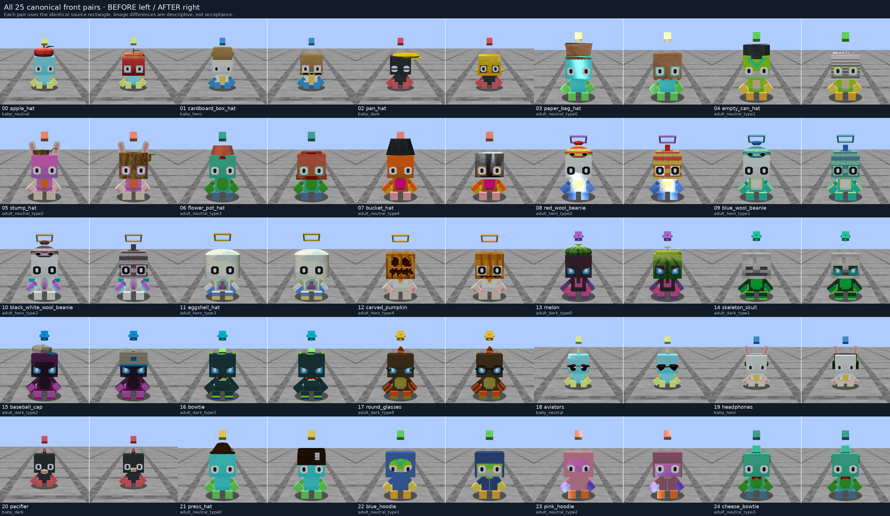

# Headwear and accessories — 0.25.79


The headwear pass replaces perched or distorted wearable shapes with block translations that fit the unchanged Chao head, restores readable face accessories, and gives outfits articulated sleeves and hood variants. Existing item identities, wardrobe slots, voluntary choice, removal and save/network paths are preserved.

All three wool items are now worn as knitted full-head masks with pompoms and real rectangular iris openings. The twelve custom legacy covers use open-neck shell panels instead of stretching full source objects into old crown boxes. Pumpkin and skeleton adapters likewise use fitted worn shells with real eye ports and native Minecraft texture regions. Their ordinary Minecraft inventory/block presentations are unchanged.

The later actual-client review found two additional issues: the press crown sat partly inside the head, and the pumpkin’s painted eye artwork appeared above its real iris openings. The final frozen source enlarges the press walls outside the fixed head and remaps pumpkin front UVs so its eye artwork falls in the openings while retaining its mouth.

CWE accessories now use complete stepped spectacle fronts, joined temple arms, a solid headphone band and cups, a shield/nipple/open-loop pacifier, source-colored bows, and block outfits with white trim that remains white under dye. Hoodies include sleeves and a raised head-attached hood; existing headgear priority selects a body-attached folded hood instead. Item models assemble the complete garment.

## Scope and catalogue

The inventory covers **25 canonical wearable items**, plus the hidden `chao_garden:watermelon_hat` compatibility identity. It is derived from the registration factories and authoritative equipment classifier, not shop lists. There are 23 registered mod wearables including the compatibility item and three vanilla item adapters.

| Canonical identity | Wardrobe slot | Category | Final actor capture |
|---|---|---|---|
| `chao_garden:apple_hat` | HEAD | legacy hat | 5 views, freeze02 |
| `chao_garden:cardboard_box_hat` | HEAD | legacy hat | 5 views, freeze02 |
| `chao_garden:pan_hat` | HEAD | legacy hat | 5 views, freeze02 |
| `chao_garden:paper_bag_hat` | HEAD | legacy hat | 5 views, freeze02 |
| `chao_garden:empty_can_hat` | HEAD | legacy hat | 5 views, freeze02 |
| `chao_garden:stump_hat` | HEAD | legacy hat | 5 views, freeze02 |
| `chao_garden:flower_pot_hat` | HEAD | legacy hat | 5 views, freeze02 |
| `chao_garden:bucket_hat` | HEAD | legacy hat | 5 views, freeze02 |
| `chao_garden:red_wool_beanie` | HEAD | legacy hat | 5 views, freeze02 |
| `chao_garden:blue_wool_beanie` | HEAD | legacy hat | 5 views, freeze02 |
| `chao_garden:black_white_wool_beanie` | HEAD | legacy hat | 5 views, freeze02 |
| `chao_garden:eggshell_hat` | HEAD | eggshell mask | 5 views, freeze02 |
| `chao_garden:baseball_cap_accessory` | FEET | head accessory | 5 views, freeze02 |
| `chao_garden:bowtie_accessory` | LEGS | neck accessory | 5 views, freeze02 |
| `chao_garden:round_glasses_accessory` | OFFHAND | face accessory | 5 views, freeze02 |
| `chao_garden:aviators_accessory` | OFFHAND | face accessory | 5 views, freeze02 |
| `chao_garden:headphones_accessory` | FEET | head accessory | 5 views, freeze02 |
| `chao_garden:pacifier_accessory` | OFFHAND | face accessory | 5 views, freeze02 |
| `chao_garden:press_hat_accessory` | FEET | head accessory | 5 views, freeze02 |
| `chao_garden:blue_hoodie_accessory` | CHEST | outfit | 5 views, freeze02 |
| `chao_garden:pink_hoodie_accessory` | CHEST | outfit | 5 views, freeze02 |
| `chao_garden:cheese_bowtie_accessory` | LEGS | neck accessory | 5 views, freeze02 |
| `minecraft:carved_pumpkin` | HEAD | vanilla hat adapter | 5 views, freeze02 |
| `minecraft:melon` | HEAD | vanilla hat adapter | 5 views, freeze02 |
| `minecraft:skeleton_skull` | HEAD | vanilla hat adapter | 5 views, freeze02 |

For Chao, FEET means head accessory, OFFHAND means face accessory, LEGS means neck accessory and CHEST means outfit. These are existing entity storage slots, not player armor placement. Eight CWE accessories support wardrobe dyeing; round glasses and aviators do not.

The old `chao_garden:watermelon_hat` stays registered and hidden for save compatibility, then canonicalizes to `minecraft:melon` with count and explicit components retained. There are no separate pumpkin-hat or skull-hat item registrations. Renderer kinds such as `vanilla_carved_pumpkin` are not extra item identities.

The coverage matrix distinguishes obtainable equipment from eight earned medal tiers, the birthday party hat, the merchant’s glasses/mask, hoodie helpers and related cosmetic effect gifts. Medals, birthday headwear and merchant cosmetics have source/asset review; the final capture catalogues explicitly mark their runtime coverage false. They are not silently counted among the 25 captured wearable items.

## Source references and anatomy

The visual references are exact retained owner-supplied SA2 source assets and CWE 9.6.2.2 configurations/models. Thirty-nine retained original inputs were hash-checked during the source audit. The work did not run the original games or use original-game footage as its verification. The new forms are Minecraft block translations using the source designs, colors and texture regions, not a claim of unchanged source topology. The source beanie black oval artwork is not proof that the original mesh had literal holes; the rectangular iris ports are an explicit adaptation.

All twelve custom covers have nonempty geometry in thirteen stored hat rigs: 156 resource combinations. The current normal gameplay rig checks cover three alignments, five adult first types, nine development endpoints and three strengths. These counts describe resource and numerical coverage; they do not establish every possible rare, character, themed or third-party head presentation.

The existing rule concealing first-type crests/head decorations under headwear remains. Saved anatomy is retained. Existing vanilla closed-mask animal overlay policy remains, while custom covers continue to preserve their existing animal overlays.

**Known visual limitation:** tall animal ears may still protrude through the solid portions of full head covers, as seen in the stump-hat case. This update does not add a blanket animal-part hiding rule or erase genes to conceal that behavior.

## Completed validation

| Check | Recorded result |
|---|---|
| Final source freeze02 | All 9,414 files match; no missing/mismatched files. Exactly eight changes from freeze01; the other 9,406 files are unchanged. |
| Final attachment run03 | Exit 0; 486 selected baby/adult states, 2,430 moving frames, 38,880 equipment fits and 24,183,360 emitted vertices. |
| Spectacle front / temple checks | Minimum sampled clearance about 0.18 / 0.08 model pixels; joined positive transforms and complete fronts checked. |
| Cap/press crown wall rays | 160,380 exterior wall rays; minimum selected outer-wall clearance about 0.17 pixels. This is exterior coverage, not minimum clearance for every inner surface. |
| Pumpkin native UV regression | PASS; four head/eye profiles, zero painted-eye samples outside ports, all 42 dark mouth texels retained. The old mapping exposes the defect as a negative control. |
| Prone, quiet and active toy rigs | All passed in final attachment run03; recorded failure counts zero. |
| Focused core / face / companion carry / idle run02 | Exit 0. Those checks passed before the isolated eight-file freeze02 correction; final attachment checks cover the corrected worn surfaces. |
| Canonical actor catalogue after03 | Exit 0; 25 cases, 125 images, five views per item, frozen02. State/equipment/PNG hashes and actual production-renderer metadata verified. |
| Full-cover plus round-glasses fit02 | Exit 0; 15 combination cases, 75 images; hashes and actual actor metadata verified. |
| Actual inventory GUI grid01 | Exit 0; all 25 canonical identities rendered through actual GUI item rendering; image hash verified. |
| Dropped world items01 | Exit 0; all 25 identities, 125 images via actual ItemEntityRenderer/GROUND context; image/state/item metadata verified. |
| Native server GameTests | 4,657 cases completed: 4,628 passed, 29 failed. All 50 new wearable lifecycle cases and all 19 existing hat cases passed. The 29 names and full reasons exactly match accepted 0.25.78; see the failure section below. |
| Native motion mode01 | Exit 0; 10 cases, 65 images, five once previews and five explicit loop/stop cases with active/second-cycle/recovery evidence. |
| Silent client recording | Completed and hash-verified: 126.266667 seconds, 1,893 frames, 960×666 at 15fps. Sampled frames and active/recovery contact sheets reviewed; uninterrupted playback was not assessed. |

The before bundle contains the same 25 canonical items in 125 actor views and a 25-item GUI grid. Its independent integrity audit made 3,112 checks with zero errors. The final catalogue uses matched fixture state, UUID and real equipment; screenshots are rendered by the actual synchronized entity and production layers. The 25 item cases rotate through eighteen baseline form labels, one assigned form per item. This is not a 25-item × 18-form visual matrix.

Visual review covered all 125 catalogue views during quality checking. After the two corrections, the final 25 front views and corrected pumpkin/press front, side and overhead views were inspected. The final before/after sheet uses matching fixture state, UUID, equipment and declared camera settings; camera extrinsic matrices were not independently recorded. See the comparison images below.

The GUI grid exercises the inventory-icon overrides. A separate completed dropped-item run exercises the GROUND base model: all 21 custom imported item identities use a distinct 3D base presentation, the three Minecraft items use their native presentation, and the existing eggshell item remains a generated sprite. This world-item run is after-only; no matched before world-item bundle exists. It does not by itself test held or item-frame display contexts.

Real equipment and arbitrary custom components are checked by native fixtures, including post-removal component equality. The tests inject an accepted latched choice through the existing saved-state fixture; they do not measure natural acceptance probability. Existing rejection, failed-return, reentry and legacy migration suites remain complementary. The production registry/classifier, care/network, entity/egg save and anatomy-policy files match their initial audit hashes.

## Motion previews and remaining limits

Existing operator commands use the production animation and preview cleanup paths:

```text
/chao testidle list
/chao testidle look_around once
/chao testidle think loop
/chao testidle stop
/chao testtoy list
/chao testtoy crayons once
/chao testtoy toy_car loop
/chao testtoy stop
```

The completed mode01 run used the native command dispatcher for look-around, thinking, ground play, crayons and toy car in five once cases and five loop/stop cases while wearing combinations. All ten cases captured clean recovery with preview tokens cleared; five loop cases also captured a second active cycle. All 55 active/second-cycle frames preserve the fixture state byte-for-byte and stable gear throughout. Five once recovery frames also match exactly. Five loop recovery frames show only ordinary age, illness-cooldown and gradual-growth/checkpoint clocks advancing for 8–16 ticks after playback stops; no other state changes were observed. This is resumed gameplay time, not a claim that all 65 state strings are identical.

The direct client recording is hash-verified (`fdd5e0af4b454625548bf5433421c47d0211d6447494de0cbb9f80e7efb0b48e`). It is silent and cannot provide a listening pass. Forty active/recovery stills and 26 regularly sampled video frames were reviewed. This is a sampled motion review; no uninterrupted video playback or listening pass is claimed. No independent remote-player/multiplayer visual confirmation is included. The local integrated-client evidence also does not exhaust every rare/character/Chaos/Omochao/themed body, all dye/coat combinations, natural refusals, every third-party resource pack, or every simultaneous wardrobe combination. Birthday hats, eight medal tiers, NPC merchant cosmetics and related effect gifts remain outside these runtime capture bundles.

## Built artifact

- File: `chao_garden-0.25.79.jar`
- Size: **30,546,507 bytes**
- SHA256: `424cca1bf5bfb13ea87c7913b5e6d4b63bf2d659d8f4a3e15e47f660614827a9`
- Source freeze02 SHA256: `ecc49951e871b46cc3f1c127cf618a9d2b9d6df9ec38db241e3c449e65f901ba`

The artifact size/hash, completed process exit codes and corresponding log hashes were independently read back. The source overlay retains accepted prior work. Dedicated-server outcomes and remaining coverage limits are stated separately from successful geometry/build checks.

## Comparisons and scope of evidence



[Front, side and rear details, sheet 1](validation-0.25.79/before-after-details-1.png) · [Sheet 2](validation-0.25.79/before-after-details-2.png) · [Complete coverage CSV](validation-0.25.79/coverage-final.csv).

The separate delivery verification archive contains original actor/item PNGs, per-frame metadata, process receipts, logs, source pins and the silent client recording. Worn accessories were inspected on actual Chao; these are not authoring projections. All screenshot runs used the ordinary client renderer with scene shader packs disabled. Physical phone controls, arbitrary shader packs, held/item-frame display contexts and an independent remote multiplayer client still need verification.

The source audit includes the merchant assembly, temporary birthday hats and related effect gifts; these remain explicit source-only visual coverage. Medal geometry follows moving body anchors in the numerical rig tests, but its eight tint tiers have no new actual-client sheet. Tall animal ears/horns and unusually tall crests with headphones need further combination-specific inspection. Full masks can also conflict conceptually with mouth-held items: no accessory is silently removed to conceal a conflict.

The recording integrity audit initially rejected 16 motion frames under a zero-lag clock assumption. The render observation and threshold checks read the server clock separately; the recorded offsets are 16 frames at -1 tick, 47 at 0, and 2 at +1. A separate bounded audit accepts only these ±1-tick recordings while retaining active-token, state and recovery checks; all 14 negative controls reject invalid timing/phases/tokens. Exact capture ticks and a universal runtime synchronization bound are not claimed. The initial failed audit is retained in the verification bundle.

## Failures and unexecuted broad gates

The dedicated-server run exited 1 because of the same **29 required failures** recorded for accepted 0.25.78. Names and full reason strings match exactly; no failures were added or removed. These comprise the existing Nether companion fire/lava-protection issue, twenty preview fixtures across crayons, picture book and two dolls/toy car, and eight pogo-stick/rocking-horse preview fixtures. The Nether issue is an existing gameplay defect; these are not all dismissed as harmless fixtures. New wearable lifecycle cases and existing hat cases are green.

The scoped build and attachment tasks passed. This update did not rerun the entire historical `check` graph: nine morphology test mains already contain stale protected-model SHA preflights documented in the accepted 0.25.78 report. Their test sources and protected body assets were preserved; no pass is claimed for skipped broad gates. The old broad SA2 validator also stops at the previously revised castanets model route, and the old broad CWE validator reaches prior guitar/accordion volume limits. Those toy assets were not changed in this update. Focused headwear and clothing validators pass without weakening those old toy assertions.

All production assets/data in the installable JAR were compared with accepted 0.25.78: **8,146 unchanged**, **105 reviewed wearable changes**, **30 wearable additions**, **zero removals**. No body/morphology assets were changed. Registry, care/network, entity/egg save and established anatomy concealment policies retain their prior hashes. Full old-world restart and independent remote-client rendering remain outside this run; entity/carrier save/load and authoritative equipment transactions were exercised on the dedicated server.
